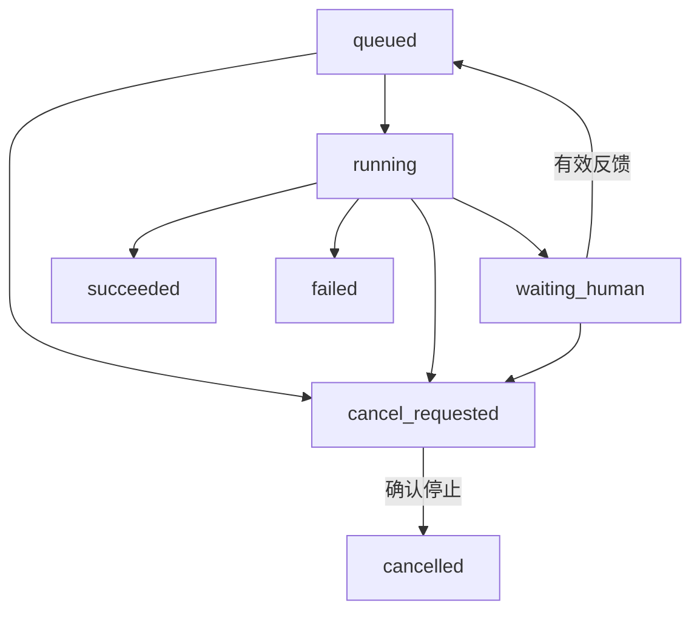

用户上传一份 Excel，Agent 调用模型制定分析步骤，再让沙箱运行代码，把报告保存到 OSS。执行到一半，用户刷新了页面。后台任务应该继续吗？如果这时 Worker 也重启了，又该从哪里接着做？

这些问题需要在任务设计时给出答案。执行位置、已完成结果和等待条件有了明确记录，换一个进程才有可能继续处理。工具产生的外部效果，还需要单独考虑重复执行。

这篇接着 [计算平台与生命周期](/posts/agent-infra-k8s-serverless/) 展开。完整阅读顺序见 [系列导读](/posts/agent-infra-overview/)。

> 本文由 AI 辅助整理，技术资料核对于 2026 年 11 月 12 日。下文是机制说明与设计示例，未进行生产环境压测；接口和数据字段用于表达职责，不构成完整实现。

## 四种恢复，处理四个不同的问题

先把几个经常混在一起的动作分开：

| 层次 | 恢复了什么 | 还需要处理什么 |
| --- | --- | --- |
| SSE 重新连接 | 前端重新接收消息 | 断开期间的事件怎样补发 |
| Worker 或 Pod 重启 | 程序重新运行 | 原来的执行位置和内存变量 |
| 检查点或工作流恢复 | 已保存的任务状态 | 哪些步骤需要重新执行 |
| 业务幂等与对账 | 避免操作重复生效 | 外部系统到底有没有完成操作 |

例如，K8s 可以重新创建失败的 Worker，原进程内存里的分析计划、Python 对象和打开的文件句柄，需要由应用重新建立。它的[自愈能力](https://kubernetes.io/docs/concepts/architecture/self-healing/)主要围绕工作负载实例。

所以设计恢复时，我会先问：**什么状态必须活过进程重启，什么工作允许重新计算，什么操作重复执行会产生问题？**

## 让任务拥有独立的身份

对于这个分析任务，可以把入口设计成两个职责：API 接收请求和展示状态，Worker 负责执行。

下面是一组示意接口，路径只用于说明关系：

```text
POST /runs                 创建任务，返回 run_id
GET  /runs/{run_id}         查询当前状态和结果
GET  /runs/{run_id}/events  接收执行事件
POST /runs/{run_id}/cancel  请求取消
```

创建任务时，先完成鉴权、输入校验和持久记录，再安排后台执行。前端保存 `run_id`，刷新以后仍然可以找到同一项工作。关闭页面是否意味着取消，则由产品规则明确决定，后台任务无需依赖某一条浏览器连接存活。

几个标识也应区分：`run_id` 标识整次任务；`step_id` 标识一次逻辑步骤；`attempt_id` 标识该步骤的某次执行尝试；`event_id` 标识一条对外事件。一次重试产生新的执行尝试，同一业务动作的身份应保持稳定。

任务状态可以先覆盖下面的分支：



这张图是一个起点。每次状态转换，都应该检查当前状态和版本，防止两次恢复请求、取消请求与执行结果同时修改同一任务。实际系统还需规定取消与成功同时到达时的处理顺序。

## 保存足以继续工作的状态

对于 Excel 分析，检查点里可以记录输入文件的对象地址、当前步骤、已完成的工具结果、待审批内容、任务版本和错误信息。较大的文件仍然保存在对象存储，检查点保存引用。

这里要区别长期记忆与执行状态。用户习惯用哪种图表，是以后可能有用的信息；当前报告已经完成了哪张表的统计，是这次任务恢复所需的信息。[LangGraph Persistence](https://docs.langchain.com/oss/python/langgraph/persistence) 用 checkpointer 保存线程内的图状态，用 store 保存跨线程的应用数据。只使用内存中的检查点存储器，例如 `InMemorySaver`，无法让状态活过进程重启。

检查点也有粒度。把“读取文件、生成代码、执行分析、上传报告”塞进一个大步骤，恢复时可能需要重新执行很长一段。将昂贵操作和外部写操作拆成边界清晰的步骤，可以更容易保存结果和处理重试。

**恢复从框架定义的边界开始。** 例如 LangGraph 的 `interrupt()` 恢复时，所在节点会从头运行，之前的代码可能再次执行；这不是保存了任意指令位置的进程快照。节点内已经发生的写操作需要考虑幂等，详见[中断与恢复规则](https://docs.langchain.com/oss/python/langgraph/interrupts#rules-of-interrupts)。

沙箱本身也可能被回收。若恢复依赖其中的中间文件，就要把必要文件持久化，或者保存能重新生成它们的输入、代码与版本。

## 队列怎样把工作交给下一个 Worker

队列负责安排任务交付，ACK 表示消费者对消息的确认。确认时间会影响故障后的行为：提前确认后进程退出，消息可能不会重新交付；完成后再确认，则需要应对工作已完成、确认尚未到达时的重复投递。

因此，使用支持至少一次交付的机制时，要按“同一任务可能再次到来”设计消费者。确认模式、连接丢失、超时和 Worker 异常退出的行为，需要按所用框架核对。[Celery 的任务文档](https://docs.celeryq.dev/en/stable/userguide/tasks.html) 就分别讨论了幂等、`acks_late` 和 Worker 丢失时的处理。

还有一个容易遗漏的窗口：数据库已经保存任务，向队列发消息却失败了。可用的设计之一是事务性发件箱：在同一个数据库事务里保存任务和待发送事件，再由投递进程发送；发送失败就继续重试。接收端仍要处理重复消息。[AWS 的 transactional outbox 说明](https://docs.aws.amazon.com/prescriptive-guidance/latest/cloud-design-patterns/transactional-outbox.html) 描述了这类双写问题。

任务接管时也需要谨慎。租约可以理解为需要定期续期的临时执行权；租约过期，只说明旧 Worker 没有及时续约，不能证明它已经停止。[Redis 分布式锁文档](https://redis.io/docs/latest/develop/clients/patterns/distributed-locks/)也明确讨论了锁的有效期边界。当前执行者的版本校验可以限制过期结果写回；若要约束外部写入，可以让接收方校验随接管递增的执行序号，即 fencing token，并拒绝旧序号。一个过期锁无法独自覆盖这整条链路。

## 超时以后，工具到底执行成功了吗

假设 Worker 调用工具创建一条报告记录。工具已经写入数据库，但返回响应时网络断了。Worker 看到的是超时，外部系统看到的是成功。

这时直接再创建一次，就可能出现两条记录。仅靠 Worker 在调用之后写一条“完成日志”，也会留下调用成功、日志未保存的故障窗口。

我会给同一个逻辑动作分配稳定的幂等键，并要求执行写操作的服务将业务写入、幂等键检查和结果记录放在同一个事务或一致性边界内。如果实际写入发生在另一个系统，就需要由最终接收方兑现幂等，或保留结果核对机制。重试携带同一个键时，返回已有结果；如果用户修改了操作内容，需要建立新的动作版本。`attempt_id` 每次重试都不同，通常不适合直接充当这个键。

[Temporal 的 Activity 文档](https://docs.temporal.io/activity-definition#idempotency) 明确讨论了同类情况：Activity 完成业务操作、但尚未报告完成时发生故障，可能再次执行。持久工作流能够记录和恢复执行过程，外部业务效果仍需要接收方落实幂等。

如果外部接口没有幂等能力，可以利用业务唯一标识查询结果，再进行对账；结果无法确定时，保留明确的待核对状态。把“不知道是否成功”立即改成“失败并重试”，会丢失一个很重要的事实。

重试也需要预算。暂时性的连接失败可以退避后再试，参数错误应先修正，权限不足应停止并报告。每一步都应有超时、最大尝试次数和总截止时间，避免多层重试相乘。

## 流式事件要能补发，也要能去重

任务继续运行以后，前端怎样重新看到进度？我倾向于让数据库里的任务状态作为查询依据，再给关键事件保存 `event_id` 和所属 `run_id`。前端重连时，从最后收到的位置继续读取。

[SSE 标准](https://html.spec.whatwg.org/multipage/server-sent-events.html#the-last-event-id-header) 定义了浏览器 `EventSource` 重连时携带 `Last-Event-ID` 的方式。服务端仍然要保存并补发事件；若用 `fetch` 自己解析流，也需要自行维护游标和重连逻辑。游标过期、历史已清理时，可以重新读取任务快照；快照应携带与其状态对应的事件游标，服务端从这个位置续读并衔接实时订阅，避免在读取快照和建立订阅之间漏掉事件。

Redis 的不同用法也有不同语义。[Pub/Sub](https://redis.io/docs/latest/develop/pubsub/#delivery-semantics) 是至多一次投递，订阅者断开期间的消息无法自动补回。[Streams](https://redis.io/docs/latest/develop/data-types/streams/) 能保留消息并支持消费者组，但故障后的数据保留能力还取决于[持久化策略](https://redis.io/docs/latest/operate/oss_and_stack/management/persistence/)、复制和消息裁剪设置。

实时通知可以用于唤醒前端，关键的完成、失败和人工待办则需要有可查询的记录。重复收到事件时按 ID 去重，也比假定整条链路永远只推送一次更容易实现。

## 等待人工与取消，需要真正结束资源占用

如果分析结果需要用户确认后才能写入业务系统，保存报告版本、拟执行动作、允许处理的人和等待条件，再把任务置为 `waiting_human`。等待可能持续很久，可以释放 Worker 和可重建的沙箱资源。

用户回来时，重新检查权限、动作内容和版本，再安排恢复。相关交互在 [Agent 的 HITL 设计](/posts/ai-agent-hitl/) 中有更完整的讨论。

取消则是另一条控制流程。先记录 `cancel_requested`，让 Worker 在可中断边界检查，并把取消传递给工具、子进程和沙箱。确认执行已经停止后，才标记为 `cancelled`。外部已经提交的写操作可能无法撤回，需要记录结果并按业务规则补偿。

如果工具无法立即停止，前端应展示“正在停止”以及当前步骤。仅关闭 SSE 连接，并不能说明后台已经结束。

## 用四个故障场景检查第一版

第一版可以从这四组验收开始，每次都核对任务状态、工具实际结果和前端展示：

1. **刷新页面。** 后台继续分析，重新进入能看到任务快照和后续事件；重复事件不会重复展示。
2. **终止 Worker。** 新 Worker 能接管任务，已保存结果可以复用，必要文件能重新获得。
3. **让工具完成写入后丢失响应。** 重试没有新增重复报告，结果不确定时能够进入查询或核对流程。
4. **在等待人工时发布新版。** 原任务仍能被识别；恢复要核对版本和权限；再次提交同一批准不会重复执行。

这些演练会把可靠性的边界显露出来：任务在哪一刻被持久接受、一步工作在哪一刻算完成、谁可以恢复它，以及重复执行最终会影响什么。

---

上一篇：[Agent 工程运维（三）：K8s 与 Serverless](/posts/agent-infra-k8s-serverless/)  
下一篇：[Agent 工程运维（五）：监控、扩容与上线维护](/posts/agent-infra-production/)  
返回：[Agent 工程运维系列导读](/posts/agent-infra-overview/)
