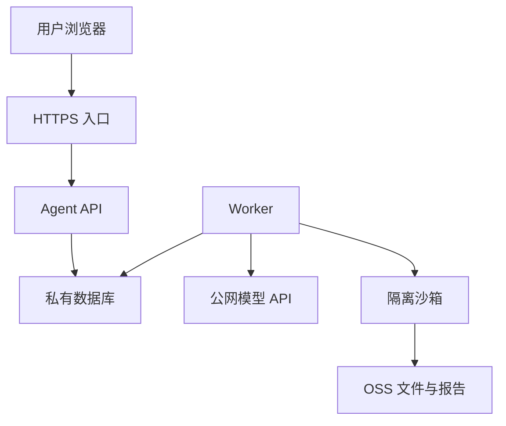

[系列导读：Agent 工程需要哪些运维知识](/posts/agent-infra-overview/)

之前写过 [Devops概念梳理](/posts/devops/)，主要从 Docker 和 K8s 入手。最近做 Agent，接触到的运行环境更多了：API 在一个地方，工具在沙箱里，数据库走内网，模型又需要访问公网。一个任务没有执行下去，首先得知道是哪条连接出了问题。

这一篇先把网络串起来。目标是能看懂一次访问的来源、目的地和中间路径，再判断问题发生在哪一层。

> 本文由 AI 辅助整理。文中的地址、命令和架构用于理解机制，不代表生产环境配置或实测结果；云产品的具体能力以所选产品与网络模式为准。

## 从一份 Excel 开始

假设用户上传一份 Excel，让 Agent 分析销售情况。API 创建任务并返回 `run_id`，Worker 获取任务、调用模型，把分析代码交给隔离沙箱执行，最后将报告写入 OSS，前端接收进度事件。

只看网络，这次任务已经涉及几条不同的连接：



这张图只表示主要访问关系，省略了任务调度和事件传递。浏览器能打开页面，只证明入口这一段基本可用。Worker 能否访问模型、沙箱能否上传报告，还需要分别检查。

排查时，我会先问四个问题：**谁在发请求，访问什么地址，走什么路径，哪些规则允许它通过。**

## 地址、端口和域名各管一件事

IP 地址用于定位网络接口，端口用于区分相应地址上的服务。例如同一台机器可以同时运行 API 和数据库，它们通过不同的监听端口接收连接。

域名则给地址增加了一层名称。程序访问 `model.example.com` 时，需要先通过 DNS 得到相应地址，再建立连接。内网域名与公网域名可能使用不同的解析环境，因此本机能解析，不代表云上的 Worker 一定能解析到同一个结果。

还要区分**访问地址**和**监听地址**。程序监听 `127.0.0.1`，通常只接收当前网络空间的回环访问；监听 `0.0.0.0` 表示在所有 IPv4 接口上监听。后者也不意味着服务自动对公网开放，外部访问还受端口映射、路由和安全规则约束。

域名解析成功，只是接下来的连接有了目的地。端口没监听、路径不通、TLS 证书不匹配，都可能让请求继续失败。

## 网段是怎么划出来的

先看一组示意地址：

| 资源 | 地址范围或地址 |
| --- | --- |
| VPC | `10.20.0.0/16` |
| 应用子网 | `10.20.1.0/24` |
| 数据库子网 | `10.20.2.0/24` |
| 一个 Worker | `10.20.1.10` |
| 数据库 | `10.20.2.10` |

这里的 `/16`、`/24` 是 CIDR 前缀长度。IPv4 地址有 32 位，`/24` 表示前 24 位作为网络前缀，剩下 8 位用于这个范围内的地址变化。因此 `10.20.1.0/24` 覆盖从 `10.20.1.0` 到 `10.20.1.255`，数学上共有 `2^(32-24) = 256` 个地址。[CIDR 定义](https://datatracker.ietf.org/doc/html/rfc4632)

**256 是地址总数，不能直接当作可部署实例数量，也不能统一写成 254 个可用地址。** 云平台会保留部分地址，实际还要看平台分配规则。

前缀数字越大，地址范围越小。`/16` 比 `/24` 大，应用子网和数据库子网都可以从上面的 VPC 地址范围中划出。

另一个容易混淆的地方是：两个隔离的 VPC 可以使用相同的私有地址。它们各自运行时未必有问题，但需要互联时，重叠网段会让路由难以判断目的地。规划地址时，应一起考虑公司内网、其他 VPC 和后续接入的网络。

## VPC、子网、路由和安全组怎样配合

VPC 是云上的逻辑隔离网络。创建 VPC 后，可以选择地址范围、划分子网、配置路由等。在阿里云里，子网通常通过交换机 vSwitch 创建。[VPC 官方说明](https://www.alibabacloud.com/help/en/vpc/what-is-vpc)

这几个概念可以放在同一次访问中理解：

| 概念 | 对这次访问的作用 |
| --- | --- |
| VPC | 确定资源所属的私有网络环境 |
| 子网 | 从较大范围中划出一部分地址，组织资源 |
| 路由表 | 根据目的地址决定下一跳 |
| 安全组等访问规则 | 判断相应来源、方向、协议和端口是否放行 |

Worker 访问 `10.20.2.10:5432` 时，要有通往该地址的路径，也要满足相关访问规则。到达数据库端口后，还需要通过数据库自己的账号认证。

因此，“在同一个 VPC”只能说明一部分网络条件。它没有自动授予数据库读写权限。类似地，划出两个子网，也不能直接推导出两个子网已经隔离。需要结合路由、安全组、网络 ACL 等规则判断。[访问控制说明](https://www.alibabacloud.com/help/en/vpc/access-control)

路由表也不是网站里的 URL 路由。网络路由关心目的 IP 和下一跳；应用路由关心 `/runs` 这样的路径由哪个处理函数接收。两者处于不同层次。

## 公网入口与公网出口要分别设计

用户访问 Agent，是外部请求进入系统；Worker 调用模型，是系统主动访问外部。这两个方向需要分别配置。

入口侧通常会看到域名、HTTPS、负载均衡和反向代理。负载均衡把请求分发给多个 API 实例，反向代理可以按域名或路径转发。实际产品可能同时提供这些能力。

出口侧则要看资源通过什么路径访问互联网。VPC 内的多个 Worker 可以通过 NAT 网关的 SNAT 能力，共享一个或多个 EIP 访问外部服务。对方看到的是转换后的出口地址。如果模型网关要求源 IP 白名单，就需要确认真正使用的是哪个出口 IP。[VPC 公网访问说明](https://www.alibabacloud.com/help/en/vpc/public-network-access/)

EIP 是公网地址资源，NAT 负责相应的地址转换。NAT 本身不能替代应用鉴权，也不代表所有出站目标都值得放行。

函数计算还有平台自身提供的网络能力。阿里云 FC 当前支持同时配置公网访问和 VPC 访问，因此不能推导成“接入 VPC 后必然断网”。需要固定出口时，可以采用通过 VPC 的 NAT 和 EIP 出站的方式，并核对公网访问开关及路由。[FC 网络配置](https://help.aliyun.com/zh/functioncompute/configure-network-settings)

对于 Excel 场景，我会分别验证：Worker 能访问私有数据库、Worker 能调用模型、沙箱能访问指定的 OSS 对象。三项验证通过，才说明这些依赖路径都符合预期。

## 容器里的 localhost 指向哪里

本地开发时，Redis 和 API 都在同一台机器上，使用 `localhost:6379` 很自然。将它们分别放进普通 Docker 容器后，API 中的 `localhost` 通常指向 API 容器自己的网络空间。

若两个容器连接到同一个用户定义网络，可以使用服务名访问，例如 `redis:6379`。这里一般使用 Redis 的容器端口，而不是为了让宿主机访问而映射的另一个端口。[Docker 网络说明](https://docs.docker.com/engine/network/)

这个规则也有边界。host 网络模式、显式共享网络空间，以及 K8s 同一 Pod 内的容器，都需要按实际网络结构解释。K8s 同一 Pod 中的容器共享网络空间，彼此可以通过 localhost 通信。[Kubernetes 网络模型](https://kubernetes.io/docs/concepts/services-networking/)

所以遇到 `connection refused` 时，我会先确认请求到底发向哪个网络空间，再检查目标服务是否在预期地址和端口监听。

## 按连接发生的顺序排查

检查应尽量从真正发起请求的环境执行。电脑上访问成功，只能说明电脑所处的网络正常；Worker 的 DNS、路由和出口可能完全不同。

| 检查层次 | 主要问题 |
| --- | --- |
| DNS | 域名能否解析，结果是否符合预期？ |
| TCP | 目标地址与端口能否建立连接？ |
| TLS | 证书、域名和信任链是否匹配？ |
| HTTP | 返回了什么状态码，代理是否超时？ |
| 应用 | 凭证、请求参数、配额和业务状态是否正确？ |

下面只是排障命令片段，地址和端口需要替换为实际环境：

```sh
# 检查解析结果
dig api.example.com

# 检查目标 TCP 端口；参数可能因 nc 实现而不同
nc -vz -w 3 db.internal.example 5432

# 查看连接、TLS 与 HTTP 阶段的信息
curl --connect-timeout 3 --max-time 10 -v https://api.example.com/health
```

`ping` 使用的探测方式与业务 TCP 请求不同，不能只凭 ping 失败判断 API 不可用。连接拒绝、连接超时和 HTTP 401，也应分别处理：它们提供的是不同阶段的证据。

例如 Worker 能调用模型，却连不上数据库，可以先确认使用的是数据库内网地址，再检查 Worker 是否接入目标网络、解析结果是否正确、目标端口是否可达。连接建立以后，才继续处理数据库账号、TLS 和连接池问题。直接换密码，解决不了前面的路径问题。

反过来，如果已经收到 HTTP 401，说明至少有一个 HTTP 组件作出了响应。此时还要确认响应来自入口网关还是目标应用，再检查对应的身份凭证。遇到 502 或 504，也应沿着代理与上游继续找原因。状态码能缩小范围，通常不能单独证明是哪一项配置错误。

第一轮练习，可以只启动 API 和数据库，然后依次修改服务名、端口、监听地址与访问规则，观察错误如何变化。再将 Worker 接入云上环境，验证内网数据库和公网模型两条路径。每次只改变一个条件，就更容易建立“配置变化与故障表现”的对应关系。

## 参考资料

- [阿里云 VPC 与公网访问](https://www.alibabacloud.com/help/en/vpc/public-network-access/)
- [阿里云 FC 网络配置](https://help.aliyun.com/zh/functioncompute/configure-network-settings)
- [Docker Networking overview](https://docs.docker.com/engine/network/)
- [RFC 4632：CIDR](https://datatracker.ietf.org/doc/html/rfc4632)

上一篇：[系列导读](/posts/agent-infra-overview/) · 下一篇：[进程、容器与沙箱](/posts/agent-infra-runtime/)
