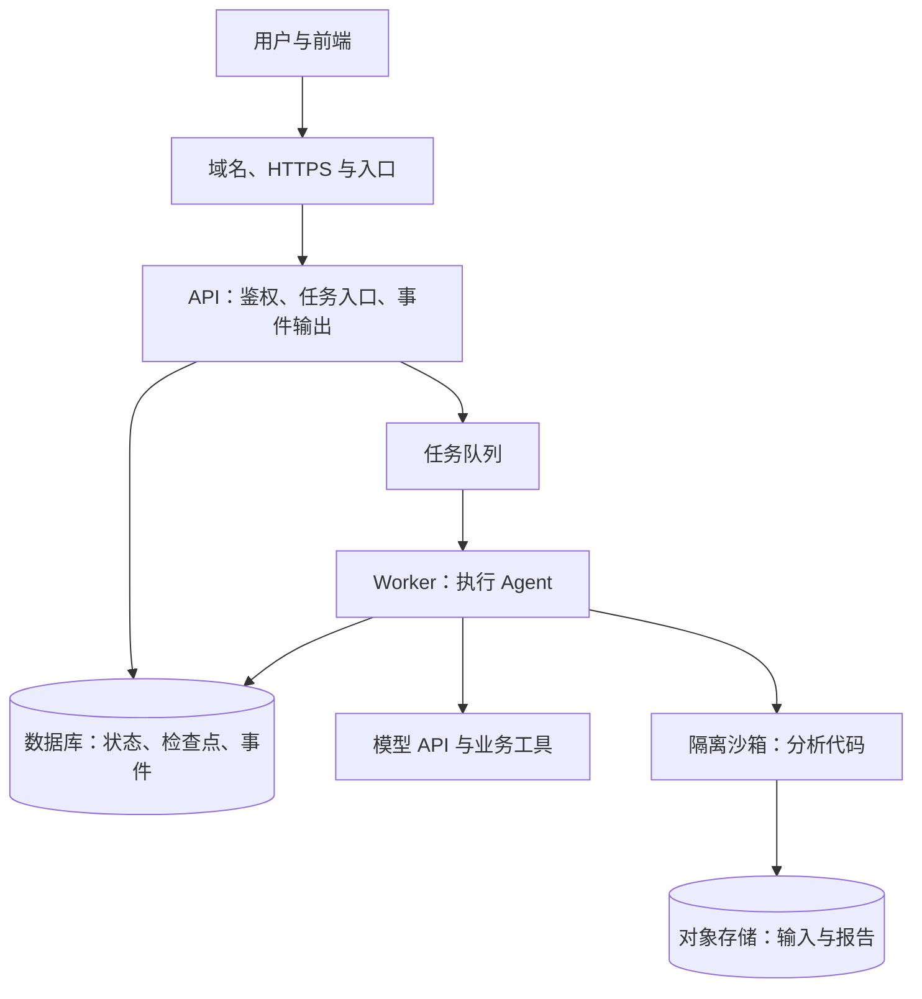

最近做 Agent，越来越需要理解基础设施。服务连不上数据库、容器启动后找不到文件，或者页面刷新后进度消失时，应该从哪一层查起？沿着这些问题继续梳理，就会遇到 VPC、网段、镜像、队列、K8s、Serverless 这些概念。

之前写过一篇 [Devops概念梳理](/posts/devops/)，从开发者的视角认识 Docker 和 K8s。这次沿着一个 Agent 任务，把网络、运行环境和执行状态连接起来。目标是能解释服务怎样运行、问题可能发生在哪一层，以及怎样验证自己的设计。

> 本系列由 AI 辅助整理，技术资料核对于 2026 年 11 月。文中的系统结构、配置片段和容量计算用于说明机制；未将示例部署到真实业务环境，也没有进行生产吞吐量压测。涉及云产品的执行时限、实例类型与计费，应以实际选用产品的官方文档和配置为准。

## 用一个任务贯穿这组文章

假设用户上传一份 Excel，让 Agent 分析数据并生成报告。

API 校验用户和文件，创建任务；Worker 获取任务，调用模型决定分析步骤；需要运行代码时，交给隔离沙箱；报告保存到对象存储；前端持续接收执行事件。如果分析过程需要用户补充口径，任务就进入人工等待。

这是一种面向长任务的逻辑拆分。小型服务可以合并部署其中一些组件；选择托管平台时，也可能由平台提供队列、事件或任务状态能力。需要明确的是每一项职责由谁承担。

这里统一使用几个名称：

- **API**：接收请求、校验身份、创建任务、提供查询和事件接口。
- **Worker**：实际推进 Agent 执行的工作进程。
- **沙箱**：运行分析代码或浏览器操作的受限环境。
- **`run_id`**：标识一次任务执行，用来关联状态、事件、日志和产物。

## 各种基础设施分别解决什么

VPC 决定资源所在的私有网络，路由决定流量往哪里走，安全规则决定哪些访问被允许。Docker 将程序和运行依赖打包为镜像，K8s 管理容器工作负载，Serverless 则将部分实例与容量管理交给平台。这些能力可以组合使用。[VPC 文档](https://www.alibabacloud.com/help/en/vpc/what-is-vpc)、[Docker 镜像概念](https://docs.docker.com/get-started/docker-concepts/the-basics/what-is-an-image/)、[Kubernetes 概览](https://kubernetes.io/docs/concepts/overview/)分别描述了这些职责。

放到这个例子里，可以对应为：

| 问题 | 需要理解的知识 | 应有的判断能力 |
| --- | --- | --- |
| Worker 为什么连不上数据库 | DNS、网段、VPC、路由、安全规则 | 分清地址、路径和身份权限 |
| 程序为什么启动失败或被结束 | 进程、容器、配置、资源限制 | 解释启动、退出和文件生命周期 |
| 多个实例怎样运行和更新 | K8s、Serverless、健康检查 | 理解平台接管了哪些工作 |
| 重启后任务从哪里继续 | 队列、检查点、幂等、事件记录 | 分清重启、恢复和重复执行 |
| 用户多了以后如何维护 | 监控、配额、扩容、发布、备份 | 找到瓶颈，控制故障范围和成本 |

对 Agent 来说，还要补上一层：执行结果是否真的完成了用户目标。HTTP 请求成功、进程存活和报告正确，是需要分别观察的指标。

## 系列目录与路由

这组文章沿用博客的 `/posts/` 路由，并归入“技术”分类。各篇可以单独阅读，连起来则是一条从网络到运行维护的路径。

| 篇目 | 主要内容 | 路由 |
| --- | --- | --- |
| [导读：从本地运行到线上服务](/posts/agent-infra-overview/) | 系统结构、职责边界与学习顺序 | `/posts/agent-infra-overview/` |
| [一：从一次请求理解网络](/posts/agent-infra-network/) | IP、CIDR、VPC、DNS、入口、出口与连接排查 | `/posts/agent-infra-network/` |
| [二：进程、容器与沙箱](/posts/agent-infra-runtime/) | Linux 进程、镜像、文件、退出和隔离 | `/posts/agent-infra-runtime/` |
| [三：K8s 与 Serverless 的运行边界](/posts/agent-infra-k8s-serverless/) | Pod、Service、资源、探针、冷启动与平台选择 | `/posts/agent-infra-k8s-serverless/` |
| [四：让长任务能够恢复](/posts/agent-infra-durable-execution/) | 队列、状态、检查点、幂等、SSE 与人工等待 | `/posts/agent-infra-durable-execution/` |
| [五：监控、扩容与上线维护](/posts/agent-infra-production/) | 可观测性、容量、模型配额、成本、发布与恢复 | `/posts/agent-infra-production/` |

## 怎样边做边学

我倾向于用同一个小项目逐步增加能力。这样遇到一个概念，就能找到它对应的现象。

**第一步，把服务之间的连接弄清楚。** 本地启动 API、Redis 和数据库，分别尝试服务名、内网地址与错误端口。记录解析失败、连接拒绝、连接超时和认证失败有什么差别。

**第二步，把任务从页面连接中独立出来。** API 返回 `run_id`，Worker 在后台推进任务，状态和关键事件写入持久存储。刷新页面后，仍然能够查询当前进度。

**第三步，把同一套程序部署到实际使用的平台。** 使用 FC，就检查函数类型、网络、并发与实例生命周期；使用 K8s，就检查 Deployment、Service、探针和资源配置。先走通一条完整部署路径。

**第四步，主动制造中断。** 重启 Worker，模拟工具超时，让同一条消息重复投递，再让任务等待人工确认后恢复。观察系统有没有丢状态、重复写入或留下未回收的沙箱。

检查点与业务幂等值得放在这里一起学习。持久化执行可以帮助恢复状态，但外部写操作成功、成功结果尚未记录时发生故障，仍可能触发重复尝试。[Temporal 的 Activity 文档](https://docs.temporal.io/activity-definition)专门解释了这个失败窗口。

完成这些练习后，再根据实际瓶颈深入自动扩缩容、多可用区、基础设施即代码或更强的沙箱隔离，会更容易知道每项技术在解决什么问题。

从 [第一篇：从一次请求理解网络](/posts/agent-infra-network/) 开始。
